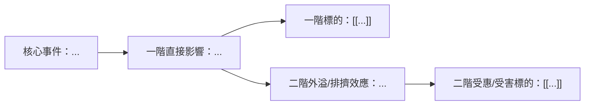
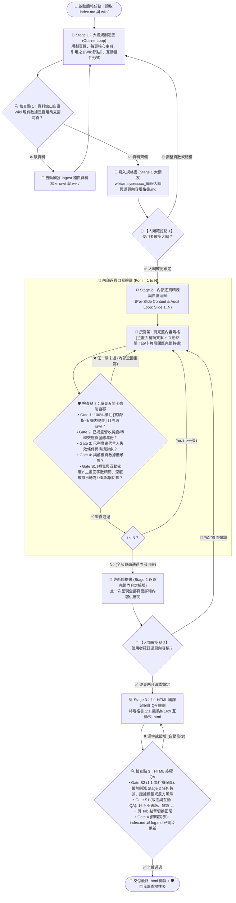

# AGENTS.md — 美台科技與 AI 供應鏈傳導知識庫 (LLM Wiki Schema)

本文件為本知識庫（LLM Wiki）的核心架構與操作規範（Schema）。所有協助維護本知識庫的 AI Agent 在執行新聞搜尋、資料收錄（Ingest）、問答（Query）與健檢（Lint）時，**必須嚴格遵守本文件之規範**。

---

## 1. 知識庫核心定位與目標

- **聚焦領域**：美股與台股之科技、半導體、AI 硬體與軟體供應鏈（US & Taiwan Tech / AI Supply Chain）。
- **核心價值**：**產業鏈與事件傳導推演（Event Transmission & Supply Chain Mapping）**。
  - 知識庫不是單純的新聞剪貼簿，而是**持續累積、交叉參照且不斷自我修正的產業傳導圖譜**。
  - 每當新消息進入時，Agent 必須推演並記錄：
    1. **一階與二階傳導路徑**：事件直接影響哪個技術或核心大廠（一階傳導）$\rightarrow$ 間接帶動、受惠、轉單或排擠哪些上下游供應商與競爭對手（二階傳導）。
    2. **多空影響與時效性標記**：明確標註對各標的之影響方向（利多 / 利空 / 中立觀察）以及時效性質（短期情緒題材 vs. 中長期基本面結構改變）。
    3. **共識演進與矛盾標記**：新消息是否強化、修正或推翻了 Wiki 中既有的市場預期與舊紀錄。
- **閱讀介面**：**Obsidian**。全面採用 `[[WikiLinks]]` 雙向連結、YAML Frontmatter 屬性（供 Dataview 查詢）與 Mermaid 傳導流程圖，最大化 Graph View（關聯圖譜）的視覺化洞察價值。

---

## 2. 目錄結構與三層架構

本儲存庫分為三個嚴格區隔的層級：

```text
HW10/
├── AGENTS.md                  # 【Schema 層】Agent 維護規範與工作流程定義（本文件）
├── index.md                   # 【導覽目錄】所有 Wiki 頁面的分類索引與一句話摘要（每次 Ingest 必更新）
├── log.md                     # 【時間軸日誌】Append-only 操作紀錄（每次 Ingest / Query / Lint 必追加）
├── raw/                       # 【原始素材層 (Immutable)】經確認收錄的新聞原文摘要、來源網址與逐字稿
│   └── YYYY-MM-DD_事件或新聞簡稱.md
└── wiki/                      # 【知識合成層 (LLM Owned)】由 Agent 撰寫與維護的互連 Markdown 頁面
    ├── companies/             # 公司/個股頁（例：NVDA 輝達.md, 2330 台積電.md）
    ├── supply-chain/          # 技術與產業鏈節點頁（例：CoWoS.md, HBM.md, 液冷散熱.md, CPO.md）
    ├── events/                # 事件與主題時間軸頁（例：CSP資本支出追蹤.md, GB200量產與供應鏈動態.md）
    └── analyses/              # 深度問答沉澱與跨主題比較專題（由 Query 轉存的分析頁）
```

### 鐵則（Golden Rules）
1. **`raw/` 不可變原則**：一旦寫入 `raw/` 的原始新聞與來源紀錄，作為事實查核基準（Source of Truth），後續不得竄改（僅能新增檔案）。
2. **`wiki/` 雙向連結與持續合成**：更新 `wiki/` 時，禁止只無腦在檔尾貼上文字；必須整合進既有段落、更新最新共識摘要、維護 `[[WikiLinks]]`，並標註資訊來源（如 `來源：[[YYYY-MM-DD_新聞簡稱]]`）。
3. **`index.md` 與 `log.md` 同步更新**：任何對 `wiki/` 的實質新增或重大修改，都必須同步更新 `index.md` 的目錄清單，並在 `log.md` 追加一筆標準格式紀錄。

---

## 3. Obsidian 命名與標記規範

### 3.1 頁面命名與 `[[WikiLinks]]` 慣例
為確保 Obsidian 圖譜（Graph View）節點唯一且直覺，所有檔名與內文 `[[WikiLinks]]` 必須遵守以下格式：

1. **公司/個股 (`wiki/companies/`)**：統一採用 **`代號 + 空格 + 常用中文/英文簡稱`**。
   - 台股範例：`[[2330 台積電]]`、`[[2317 鴻海]]`、`[[3017 奇鋐]]`、`[[2382 廣達]]`、`[[2454 聯發科]]`
   - 美股範例：`[[NVDA 輝達]]`、`[[TSM 台積電ADR]]`（通常主頁面統一連至 `[[2330 台積電]]`）、`[[MSFT 微軟]]`、`[[META Meta]]`、`[[GOOGL Alphabet]]`、`[[AMZN 亞馬遜]]`、`[[AVGO 博通]]`、`[[AMD 超微]]`、`[[MU 美光]]`
   - 韓/日/歐大廠範例：`[[000660.KS SK海力士]]`、`[[005930.KS 三星電子]]`、`[[ASML 艾司摩爾]]`
   - *提示*：在該公司頁面的 YAML Frontmatter `aliases` 中放入純代號或別名（如 `["NVDA", "NVIDIA", "輝達"]`），方便搜尋。
2. **技術與產業鏈節點 (`wiki/supply-chain/`)**：採用**最通用的技術或次產業名詞**。
   - 範例：`[[CoWoS]]`、`[[SoIC]]`、`[[HBM]]`、`[[液冷散熱]]`、`[[CPO 共同封裝光學]]`、`[[AI ASIC]]`、`[[BBU 備援電池模組]]`
3. **事件與主題 (`wiki/events/`)**：採用**具辨識度的事件或長期追蹤主題名稱**。
   - 範例：`[[四大CSP資本支出追蹤]]`、`[[Blackwell GB200量產與出貨動態]]`、`[[美國AI晶片出口管制]]`

### 3.2 多空影響與時效性標準標籤
在推演事件傳導與更新個股/產業頁面時，統一使用以下視覺化標記：

- **影響方向（Direction）**：
  - `🟢 利多 (Bullish)`：營收/毛利上修、訂單增加、市佔擴張、產能吃緊漲價、技術領先。
  - `🔴 利空 (Bearish)`：砍單、延遲出貨、良率問題、掉單/被替代、毛利壓縮、管制升級。
  - `🟡 中立/觀察 (Neutral/Watch)`：多空互抵、傳言待證實、長期結構調整中。
- **時效性質（Time Horizon）**：
  - `⚡ 短期情緒/題材 (Short-term Sentiment)`：消息面波動、單月營收雜訊、尚未證實的市場傳聞（影響週期：數天至數週）。
  - `🏗️ 中長期基本面/結構 (Mid-to-Long-term Fundamental)`：規格世代交替、資本支出趨勢、產能擴充、市佔結構洗牌（影響週期：數季至數年）。

---

## 4. 標準頁面模板 (Page Templates)

建立新頁面時，必須包含對應的 YAML Frontmatter 與結構區塊：

### 4.1 原始新聞存檔模板 (`raw/YYYY-MM-DD_事件或新聞簡稱.md`)
```markdown
---
type: raw-source
date: YYYY-MM-DD
source_type: news | earnings | report | rumor
urls:
  - "https://..."
related_nodes:
  - "[[NVDA 輝達]]"
  - "[[CoWoS]]"
tags:
  - raw
---

# YYYY-MM-DD 事件或新聞標題

## 原始新聞重點與數據摘錄
- **消息來源與發布日期**：...
- **核心事實與數據**：（保留客觀數據、金額、時間點、引述內容）

## 關聯 Wiki 頁面更新清單
- 已更新：[[...]], [[...]]
```

### 4.2 公司/個股頁模板 (`wiki/companies/代號 名稱.md`)
```markdown
---
type: company
ticker: "2330"
market: TW | US | KR | JP | EU
aliases:
  - "2330"
  - "台積電"
  - "TSMC"
  - "TSM"
supply_chain_nodes:
  - "[[CoWoS]]"
  - "[[先進製程 2nm-3nm]]"
sentiment: bullish | bearish | neutral
updated: YYYY-MM-DD
tags:
  - company
---

# 代號 名稱

## 1. 核心定位與最新基本面共識
> 一段話總結該公司在科技/AI供應鏈中的核心地位、目前最關鍵的成長動能與最新市場共識。

## 2. 供應鏈關係圖譜
- **核心技術/節點**：[[CoWoS]]、[[...]]
- **上游設備/材料/供應商**：[[...]]、[[...]]
- **主要客戶**：[[NVDA 輝達]]、[[AAPL 蘋果]]、[[...]]
- **主要競爭對手**：[[...]]

## 3. 近期事件傳導與多空影響追蹤
| 日期 | 事件 / 消息來源 | 傳導階層 | 多空評估 | 時效性質 | 影響邏輯與預期差說明 |
| :--- | :--- | :--- | :--- | :--- | :--- |
| YYYY-MM-DD | [[事件頁]] ([raw](../../raw/YYYY-MM-DD_xxx.md)) | 一階 / 二階 | 🟢 利多 | 🏗️ 中長期基本面 | 說明具體影響... |

## 4. 關鍵催化劑與風險觀察 (Catalysts & Risks)
- **未來觀察指標/催化劑**：（例：下次法說會資本支出指引、某產品良率...）
- **核心風險與矛盾點**：（例：是否有砍單傳言與官方說法矛盾...）
```

### 4.3 技術/產業鏈節點頁模板 (`wiki/supply-chain/技術或節點名稱.md`)
```markdown
---
type: supply-chain
category: 半導體封裝 | 記憶體 | 散熱 | 光通訊 | 伺服器組裝 | 電力與BBU
bottleneck_status: 產能吃緊 | 供需平衡 | 規格轉換中 | 供過於求
updated: YYYY-MM-DD
tags:
  - supply-chain
---

# 技術或產業鏈節點名稱

## 1. 技術定位與演進趨勢
> 簡述該技術解決什麼痛點、目前主流規格演進（例如 CoWoS-S -> CoWoS-L，或氣冷 -> 水冷），以及目前的供需瓶頸狀態。

## 2. 產業鏈玩家版圖 (Ecosystem Map)
- **規格制定 / 終端需求方**：[[NVDA 輝達]]、[[...]]
- **核心製造 / 代工龍頭**：[[2330 台積電]]、[[...]]
- **一階關鍵零組件 / 設備材料受惠股**：[[...]]、[[...]]
- **二階外溢 / 替代技術廠商**：[[...]]、[[...]]

## 3. 事件傳導與規格變動紀錄
- **YYYY-MM-DD**：[[事件頁]] — 摘要技術規格或產能變化如何傳導至上下游廠商（來源：[[YYYY-MM-DD_raw]]）。
```

### 4.4 事件/主題頁模板 (`wiki/events/事件或主題名稱.md`)
```markdown
---
type: event
date_started: YYYY-MM-DD
updated: YYYY-MM-DD
status: 進行中 | 已發酵 | 待驗證
tags:
  - event
---

# 事件或主題名稱

## 1. 事件核心摘要與最新狀態
> 綜合所有已收錄新聞，概述該事件的來龍去脈、最新進度，以及市場預期的演變（若前後新聞有矛盾或闢謠，必須在此明確標記）。

## 2. 一階與二階產業鏈傳導路徑


### 傳導明細與多空評估
- **一階傳導（直接衝擊）**：
  - [[公司或技術節點]]：`🟢 利多` / `🔴 利空`（`🏗️ 中長期基本面` 或 `⚡ 短期情緒`）— 詳細推演邏輯。
- **二階傳導（上下游連動 / 轉單 / 排擠效應）**：
  - [[公司或技術節點]]：`🟢 利多` / `🔴 利空`（`🏗️ 中長期基本面` 或 `⚡ 短期情緒`）— 詳細推演邏輯。

## 3. 事件演進時間軸 (Timeline)
- **YYYY-MM-DD**：發生了什麼新進展、數據更新或說法修正（來源：[[YYYY-MM-DD_raw]]）。
```

---

## 5. 標準操作工作流程 (Operations)

本知識庫具備**「主動上網找尋資料（Auto-Discovery）」**的能力。Agent 不需等待使用者手動餵入新聞，可主動根據知識庫現有節點與催化劑上網挖掘最新財經與產業動態。

### 5.1 📡 主動雷達巡邏機制 (Auto-Patrol & Discovery)

當使用者下達模糊或廣泛指令（如：「幫我自動巡邏最新新聞」、「今天有什麼重要 AI 供應鏈消息？」、「自動更新知識庫」）時，Agent 必須自動執行以下資料搜尋策略：

1. **掃描內部追蹤雷達**：
   - 讀取 `index.md` 掌握目前已建檔的核心公司與技術節點。
   - 掃描各頁面中的「關鍵催化劑與風險觀察」以及尚未建立檔案的高頻 `[[懸空連結]]`（如 `[[HBM]]`、`[[液冷散熱]]`、`[[CPO 共同封裝光學]]`、四大 CSP 等）。
2. **多維度自動聯網搜尋 (`search_web`)**：
   - 自動組合關鍵字上網搜尋最新財經新聞、法說會動態、產能與訂單傳聞，優先鎖定三大主軸：
     - **美股算力與 CSP 端**：[[NVDA 輝達]]、[[AMD 超微]]、[[AVGO 博通]] 及四大 CSP（微軟、Meta、Google、亞馬遜）之資本支出、AI 晶片規格與自研 ASIC 動態。
     - **台股半導體與先進封裝端**：[[2330 台積電]] 先進製程（2nm/3nm）、[[CoWoS]] / [[SoIC]] 擴產、設備與封測外溢訂單。
     - **AI 伺服器下游與關鍵零組件**：ODM 組裝（鴻海、廣達、緯創、緯穎）、散熱（[[液冷散熱]] 奇鋐、雙鴻）、光通訊（[[CPO 共同封裝光學]]）、記憶體（[[HBM]]）。
3. **高標準篩選（去雜訊）**：
   - 過濾純股價漲跌播報或無實質內容的農場文；僅挑選**「具備上下游一階與二階傳導價值」**（如：資本支出上修/下修、產能擴充、技術規格變更、掉單/轉單、良率與出貨時程異動、政策管制）之關鍵新聞。

---

### 5.2 🔄 資料收錄雙模式 (Ingest Modes：半自動把關 vs. 全自動寫入)

搜尋到高價值新聞後，依據使用者的指令意圖，分為以下兩種執行模式：

#### 【模式 A：全自動搜尋與寫入 (Auto-Commit Mode)】
- **觸發條件**：當使用者明確表示**「自動更新」、「自動找資料並寫入」、「全自動巡邏」**，或於背景排程執行時。
- **執行步驟（免等待確認，直接一條龍完成）**：
  1. **自動上網搜尋**並篩選出 1~3 則最具傳導價值的最新新聞。
  2. **直接建立 `raw/` 原始存檔**：將新聞日期、來源網址、關鍵數據與事實寫入 `raw/YYYY-MM-DD_事件簡稱.md`。
  3. **直接編譯並更新 `wiki/` 圖譜**：
     - 建立或更新對應的 `wiki/events/` 事件頁（含 Mermaid 一階與二階傳導流程圖）。
     - 同步更新或新建受影響之 `wiki/companies/` 與 `wiki/supply-chain/` 頁面（標註 `🟢/🔴/🟡` 與 `⚡短期 / 🏗️中長期`）。
  4. **同步更新 `index.md` 與 `log.md`**：在 `index.md` 登記新頁面並更新摘要，於 `log.md` 檔尾追加 `ingest` 紀錄。
  5. **輸出更新戰報**：在對話中向使用者報告本次自動抓到了哪些新聞、推演出的傳導路徑，以及已自動更新的 Wiki 檔案連結清單（若使用者事後有不同看法，可隨時指示微調）。

#### 【模式 B：半自動把關工作流 (Propose & Confirm Mode)】
- **觸發條件**：當使用者要求**「先幫我搜尋看看某主題」、「幫我分析這則消息（尚未要求直接寫入）」**時。
- **階段一（搜尋、推演與提案）**：
  1. 讀取 `index.md` 與既有頁面背景，並執行 `search_web` 獲取最新數據。
  2. 在對話中輸出**傳導推演提案報告**：
     - **📰 新聞核心事實摘要**（日期、來源、關鍵數據）
     - **🔗 一階與二階傳導推演**（一階直接影響 + 二階上下游外溢/排擠效應，標註 `🟢/🔴/🟡` 與 `⚡短期 / 🏗️中長期`，以及與舊共識的預期差）
     - **📝 預計異動檔案清單**（預計新增的 `raw/` 與新建/更新的 `wiki/` 頁面）
  3. 詢問使用者是否確認寫入或需微調觀點。
- **階段二（確認後寫入與編譯）**：
  - 使用者回覆確認或給出修正意見後，依序寫入 `raw/`、更新 `wiki/`、`index.md` 與 `log.md`。

---

### 5.2 💡 Query（知識庫問答與分析沉澱）

當使用者針對知識庫提問（例如：「目前 Wiki 裡受惠於液冷散熱的台廠有哪些？」、「如果 CSP 資本支出放緩，二階影響會先打到誰？」）：
1. **先查 `index.md`**：從 `index.md` 定位相關的 `companies`、`supply-chain` 與 `events` 頁面並讀取內容。
2. **綜合推演並附註引用**：根據 Wiki 累積的脈絡回答，並在答案中大量使用 `[[WikiLinks]]` 標明依據。若 Wiki 內部資料不足，可主動詢問是否要上網搜尋補充。
3. **成果沉澱（File back to Wiki）**：若該次問答產出了有價值的跨領域比較表、投資邏輯推演或產業地圖，主動詢問使用者是否將其存檔至 `wiki/analyses/主題名稱.md`，並同步更新 `index.md` 與 `log.md`（標記為 `## [YYYY-MM-DD] query | 分析主題`）。

---

### 5.3 🧹 Lint（知識庫定期健檢）

當使用者要求執行「健檢（Lint）」時，Agent 需掃描 `index.md` 與 `wiki/` 所有頁面，檢查並回報：
1. **懸空連結 (Uncreated WikiLinks)**：在多篇頁面中被 `[[...]]` 提及，但尚未建立實際檔案的重要公司或技術節點，建議是否補齊。
2. **過期時效與矛盾 claims**：先前標記為 `⚡ 短期情緒/題材` 或「待驗證傳聞」的事件，是否已有新進展可以結案或更新？不同頁面之間對同一技術/公司的多空描述是否不一致？
3. **孤島頁面 (Orphan Pages)**：缺乏雙向連結的頁面，補上與上下游節點的關聯。
4. **資料缺口建議**：根據目前的供應鏈圖譜，建議接下來值得搜尋追蹤的催化劑或法說會焦點，並記錄至 `log.md`（`## [YYYY-MM-DD] lint | 知識庫健檢`）。

---

## 6. 🛡️ 強制自我審查機制規格書 (Self-Review & Verification Spec)

為防止財經知識庫出現「將預估當事實」、「將題材沾邊當實質獲利」、「時程錯配追高」或「一面倒樂觀偏誤」，Agent 在執行任何 **資料寫入（Ingest）**、**深度分析沉澱（Query to Analysis）** 與 **簡報/報告生成（HTML Deck / Report）** 時，**必須在寫入前強制執行以下四道自我審查關卡（4 Audit Gates）**，並在完成後向使用者輸出**「🛡️ 自我審查檢核表」**。

---

### 6.1 第一關：事實分級與溯源審查 (Gate 1: Fact Grading & Source Integrity)

1. **零幻覺與 100% 溯源鐵則**：
   - `wiki/` 與任何輸出簡報（如 `.html`）中的所有財務數字、產能數據、訂單金額與時程，**必須 100% 能追溯至 `raw/` 中的原始存檔**。嚴禁在生成分析或簡報時憑空捏造或偷渡未入庫之數據。
2. **強制證據分級標籤（Evidence Tiering）**：
   - 凡引用關鍵數據或宣稱時，必須在內文或表格中明確標註其**證據等級標籤**，嚴禁將法人預估或市場傳聞包裝成既定事實：
     - **`[財報實績]`**：已公布之季度/年度財報確切數字（例：`[財報實績]` 2026Q3 毛利率 33.86%）。
     - **`[官方指引]`**：公司法說會、官方新聞稿或管理層公開承諾之目標（例：`[官方指引]` 日月光管理層宣示 30% 為封測毛利新地板、2027 LEAP 營收翻倍）。
     - **`[法人/研調預估]`**：TrendForce 等研調機構或券商法人之推估模型（例：`[法人/研調預估]` 2027 年九大 CSP 資本支出上看 1.3~1.5 兆美元、ASIC 出貨追平 GPU）。
     - **`[市場傳聞]`**：供應鏈訪查、媒體引述未具名消息人士、待官方證實之傳言（例：`[市場傳聞]` 某零組件掉單或良率卡關）。

---

### 6.2 第二關：傳導含金量與時程對齊審查 (Gate 2: Materiality & Time-Horizon Gate)

1. **實質含金量與業務純度檢驗（Revenue Purity & Dilution Check）**：
   - 評估二階受惠股時，必須檢驗**「該受惠業務佔該公司總營收/營業利益之比重」**以及**「非 AI / 傳統業務是否造成稀釋」**。
   - 若某公司切入熱門題材但相關營收佔比極低（或有龐大低毛利傳統業務拖累），必須在頁面中明確揭露，防止「假受惠（題材沾邊但對 EPS 無實質貢獻）」。
2. **發酵時程與認列年份對齊（Time-Horizon Alignment）**：
   - 必須嚴格區分：
     - **當下已兌現（Now / 當季財報）**：靠既有高階產能稼動率滿載與產品組合優化帶來之毛利跳升。
     - **中期主升段（Next 4–6 Quarters）**：新平台放量與第一波委外訂單翻倍。
     - **遠期擴廠產能（2–3 Years Out）**：簽署長約後新建廠房（如 2028–2029 到位之產能）。
   - **審查紅線**：嚴禁將 2~3 年後才開出的新廠產能，誤導為未來一兩季的短期營收暴衝。

---

### 6.3 第三關：魔鬼代言人與反方排擠審查 (Gate 3: Devil's Advocate & Squeeze Gate)

1. **利多失效條件審查（Invalidation Criteria）**：
   - 每當對一家公司或技術節點給出 `🟢 利多` 評級時，Agent 必須同時扮演「魔鬼代言人（Devil's Advocate）」，在該頁面的風險欄或分析表中強制列出**至少 1~2 項「利多失效條件或反方風險」**（例如：資本支出龐大折舊稀釋、零漏液良率卡關、上游關鍵材料如 T-Glass 玻纖布斷鏈、客戶扶植第二供應商殺價、或 CSP 自研晶片分食高毛利 GPU）。
2. **結構性受害與排擠清單（Structural Losers Identification）**：
   - 產業鏈傳導不是只有贏家。每次重大技術規格演進（如：氣冷轉向 100% 無風扇全液冷、傳統封裝轉向 CoWoS 全製程、通用 GPU 轉向自研 ASIC），必須強制推演並標記**「誰因此被排擠、邊緣化或受害（`🔴 利空`）」**。

---

### 6.4 第四關：跨頁一致性與閉環審查 (Gate 4: Schema & Consistency Gate)

1. **矛盾與預期差標記（Contradiction & Evolution Tracking）**：
   - 寫入新資料前，必須比對既有 `wiki/` 頁面。若新數據修正、強化或推翻了舊紀錄，必須明確標註「共識演進 / 預期差說明」，不得讓不同頁面出現互相矛盾的數據。
2. **四層同步閉環檢查（4-Layer Sync Checklist）**：
   - 確認 `raw/`（不可變原始檔） $\rightarrow$ `wiki/`（公司/產業鏈/事件/分析頁雙向連結） $\rightarrow$ `index.md`（總目錄摘要與更新日） $\rightarrow$ `log.md`（時間軸紀錄）四層完全同步，且簡報 `.html` 數據與 `wiki/` 完全一致。

---

### 6.5 📋 標準輸出格式：🛡️ 自我審查檢核表 (Self-Review Audit Report)

每次完成 `ingest`、`query` 深度分析存檔或產出簡報時，Agent 必須在回覆末尾（及分析專題頁末尾）附上以下標準檢核表：

```markdown
### 🛡️ 自我審查檢核表 (Self-Review Audit Report)
- **[Gate 1 事實分級與溯源]**：✅ 通過 — 所有數據皆已標註 `[財報實績]` / `[官方指引]` / `[法人/研調預估]` / `[市場傳聞]`，且 100% 溯源至 `raw/YYYY-MM-DD_xxx.md`。
- **[Gate 2 含金量與時程對齊]**：✅ 通過 — 已核實各標的之 AI/核心業務營收純度（及非核心業務稀釋效應），並明確切分 2026 當下兌現 vs. 2027–2029 遠期產能時程。
- **[Gate 3 魔鬼代言人與排擠效應]**：✅ 通過 — 已為每項 `🟢 利多` 標的列出反方失效風險，並明確點出遭規格演進排擠之 `🔴 利空` 受害環節。
- **[Gate 4 跨頁一致性與閉環]**：✅ 通過 — `raw/`、`wiki/`、`index.md`、`log.md`（及輸出簡報）數據 100% 同步無矛盾。
```

---

## 7. 🔄 投影片三階段迴圈生成與審查規範 (Slide Deck Generation Loop Spec)

當使用者要求將知識庫內容整理為簡報投影片（`.html`）時，**嚴禁一步直接跳過大綱與逐頁審查去生成 HTML**。必須嚴格執行以下**「三階段、雙層迴圈（3-Stage Nested Loop）」**工作流程，並將過程持久化於 `wiki/analyses/主題_簡報大綱與逐頁內容規格書.md`。

---

### 7.1 迴圈總覽流程圖 (Workflow Diagram)



---

### 7.2 各階段執行與檢查細則

#### 【Stage 1：大綱規劃與資料缺口檢查迴圈 (Outline & Data-Gap Loop)】
1. **建立規格書初稿**：於 `wiki/analyses/` 建立 `主題_簡報大綱與逐頁內容規格書.md`，先寫入 **Stage 1 大綱區塊**，每一頁須定義：
   - **頁碼與核心標題**
   - **本頁核心論點摘要（1~2 句話）**
   - **綁定之 `[[Wiki 節點]]` 與 `raw/` 來源**
   - **互動組件設計（UI Pattern）**：如 `4-KPI + 3欄卡`、`互動節點篩選器 + 右側詳情面板`、`雙欄橫條圖 + 排擠卡片`、`三階段時間軸 Tab`、`風險情境切換器`。
2. **檢查點 1（資料缺口自審）**：檢查每一頁規劃的內容是否已在 `wiki/` 中有具體量化數據與反方觀點支撐。若有缺口，先執行 `Ingest` 補齊 `raw/` 與 `wiki/`。
3. **人類確認點 1**：在對話中呈現大綱，**等待使用者確認或修改後**，才進入 Stage 2。

#### 【Stage 2：內部逐頁精煉與整批內容確認迴圈 (Per-Slide Content & Batch Review Loop)】
1. **內部逐頁撰寫與五關卡自審（`for slide_i in 1..N`）**：
   - Agent 針對每一頁獨立撰寫完整文案（明確區分**「靜態主視覺區文案」**與**「互動點擊切換區（Tabs / Cards）展開文案」**）。
   - 每寫完一頁，強制在內部執行 **5 項單頁檢查**：
     - **Gate 1（事實分級）**：所有數字皆已標上 `[財報實績]` / `[官方指引]` / `[法人/研調預估]` / `[市場傳聞]`。
     - **Gate 2（含金量與時程）**：已標明業務營收純度、非核心業務稀釋效應及兌現年份（2026 vs. 2027–2029）。
     - **Gate 3（魔鬼代言人）**：已包含利多失效條件與結構性受排擠對象（`🔴 利空`）。
     - **Gate 4（跨頁一致性）**：與前後頁數字完全吻合。
     - **Gate S1（視覺與互動密度檢查）**：控制靜態畫面字數上限以防 16:9 破版；凡超過版面負荷的深度數據與多情境分析，**強制拆分為「點擊切換 Tab / 節點卡片」**。
   - 若任一頁未通過上述 5 關，立即在內部退回重寫該頁，直到全部頁面皆通過。
2. **更新規格書並整批呈現**：將通過內部自審的所有頁面完整內容與每頁自審紀錄寫入 `wiki/analyses/主題_簡報大綱與逐頁內容規格書.md`，並在對話中**一次呈現給使用者審閱**。
3. **人類確認點 2**：**等待使用者確認逐頁內容定稿（或針對特定頁面微調）後**，才進入 Stage 3。

#### 【Stage 3：1:1 零耗損 HTML 編譯與 QA 迴圈 (HTML Compilation & Fidelity QA Loop)】
1. **1:1 編譯為 `.html` 簡報**：根據 Stage 2 確認鎖定的規格書內容，編譯為支援鍵盤 `←` `→` 翻頁與互動點擊切換的 16:9 HTML 檔案。
2. **檢查點 3（HTML 終極 QA）**：
   - **Gate S2（1:1 零耗損保真檢查）**：逐頁核對 HTML 內的文字、數字、證據標籤（`[財報實績]` 等）與反方失效條件，**嚴禁在轉為 HTML 時刪減或簡化 Stage 2 已確認的任何實質數據**。
   - **Gate S1（版面與互動 JS 檢查）**：確認所有 Tab / 篩選按鈕的 DOM ID 與 JS 資料陣列完全對應、無語法錯誤、16:9 容器無異常截斷。
   - **Gate 4（四層同步閉環）**：同步更新 `index.md` 與 `log.md`，並輸出最終「🛡️ 自我審查檢核表」。


