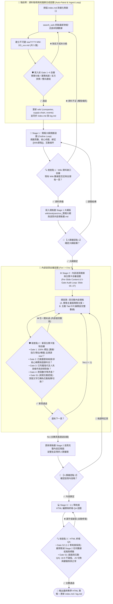

# 🌐 美台科技與 AI 供應鏈事件傳導知識庫 (LLM Wiki) & 教學型 HTML 簡報

> **作業主題**：用 LLM Wiki 做一份教學 HTML 簡報  
> **知識庫領域**：美股與台股科技 / AI 硬體供應鏈之一階與二階事件傳導推演（Event Transmission & Supply Chain Mapping）  
> **GitHub 儲存庫**：https://github.com/TW-Aki/TAICA_week10_2_hw  
> **🖥️ 教學 HTML 簡報線上直接瀏覽（免下載即開即看）**：  
> - **GitHub Pages 連結**：https://tw-aki.github.io/TAICA_week10_2_hw/  
> - **HTML Preview 備用直連**：https://htmlpreview.github.io/?https://github.com/TW-Aki/TAICA_week10_2_hw/blob/main/index.html  
> - **簡報原始碼檔案**：[`AI供應鏈實質影響分析簡報.html`](https://github.com/TW-Aki/TAICA_week10_2_hw/blob/main/AI%E4%BE%9B%E6%87%89%E9%8F%88%E5%AF%A6%E8%B3%AA%E5%BD%B1%E9%9F%BF%E5%88%86%E6%9E%90%E7%B0%A1%E5%A0%B1.html) / [`index.html`](https://github.com/TW-Aki/TAICA_week10_2_hw/blob/main/index.html)

---

## 📌 1. LLM Wiki 主題與簡短介紹

本專案建立了一個以 **「美台科技與 AI 供應鏈事件傳導」** 為核心的持久化 **LLM Wiki 知識庫**（專為 **Obsidian** 雙向連結 `[[WikiLinks]]`、YAML Frontmatter 與關聯圖譜 Graph View 設計）。

傳統財經新聞閱讀或 RAG 檢索最大的痛點在於「資訊碎片化、缺乏前後脈絡、且容易把題材沾邊當成實質獲利」。本知識庫透過嚴謹的 Schema 規範（定義於 [`AGENTS.md`](AGENTS.md)），讓 AI Agent 在每次收錄（Ingest）新聞時，不僅自動將原始素材不可變地保存於 [`raw/`](raw/)，更自動合成並維護以下知識圖譜：
1. **一階與二階產業鏈傳導推演**：區分事件直接衝擊的核心大廠（一階傳導，如 `[[NVDA 輝達]]`、`[[2330 台積電]]`、`[[AVGO 博通]]`）與因產能滿載外溢、規格升級而受惠或遭排擠的上下游廠商（二階傳導，如 `[[3711 日月光投控]]`、`[[3017 奇鋐]]`、`[[3189 景碩]]`）。
2. **AI 伺服器五大硬體咽喉節點**：完整建構 `[[CoWoS]]`（先進封裝）、`[[HBM]]`（高頻寬記憶體）、`[[液冷散熱]]`（100% 無風扇水冷）、`[[CPO 共同封裝光學]]`（矽光子光進銅退）、`[[BBU 備援電池模組]]`（800V HVDC 獨立電源櫃與備援電池）五大技術節點。
3. **Gate 1–4 強制自我審查機制**：強制為所有數據標註證據等級（`[財報實績]` / `[官方指引]` / `[法人/研調預估]` / `[市場傳聞]`）、檢驗非核心業務稀釋效應、列出「魔鬼代言人」反方失效條件與結構性受害族群（`🔴 利空`）。

---

## 📂 2. LLM Wiki 架構與成果（已 Ingest 5 篇核心產業資料）

```text
HW10/
├── AGENTS.md                  # 【Schema 層】定義命名規範、自動巡邏、Gate 1-4 自我審查與投影片三階段 Loop
├── index.md                   # 【導覽目錄】所有 Wiki 頁面的分類索引與一句話摘要
├── log.md                     # 【時間軸日誌】Append-only 操作紀錄（含 init / 5 筆 ingest / query / lint）
├── index.html                 # 【教學 HTML 簡報 (GitHub Pages 入口)】8 頁 16:9 互動式教學與實質影響分析簡報
├── AI供應鏈實質影響分析簡報.html # 【教學 HTML 簡報主檔】同 index.html
├── raw/                       # 【原始素材層 (Immutable) — 已完成 5 篇資料 Ingest】
│   ├── 2026-11-23_輝達Rubin量產與擴大投資台灣先進封裝載板供應鏈.md
│   ├── 2026-11-23_四大CSP資本支出與奇鋐日月光景碩實質毛利營收數據.md
│   ├── 2026-11-24_HBM4與HBM4E基礎裸晶Base_Die全面轉向台積電先進製程.md
│   ├── 2026-11-24_CPO共同封裝光學商轉元年與台積電COUPE及1.6T矽光子供應鏈.md
│   └── 2026-11-24_AI伺服器800V高壓直流電源機櫃與BBU備援電池標配化革命.md
└── wiki/                      # 【知識合成層 (LLM Owned)】
    ├── companies/             # 公司與個股節點（NVDA 輝達, 2330 台積電, 3017 奇鋐, 3711 日月光投控, 3189 景碩）
    ├── supply-chain/          # 五大技術咽喉節點（CoWoS, 液冷散熱, HBM, CPO 共同封裝光學, BBU 備援電池模組）
    ├── events/                # 事件傳導時間軸頁（輝達Rubin平台量產與供應鏈固樁計畫, 四大CSP資本支出與AI_ASIC黃金交叉追蹤）
    └── analyses/              # 深度專題與投影片 Loop 規格書
        ├── AI供應鏈一二階傳導與2026-2029實質基本面影響深度剖析.md
        └── AI供應鏈實質影響分析_簡報大綱與逐頁內容規格書.md
```

---

## 🖥️ 3. 教學型 HTML 簡報特色（共 8 頁 16:9 互動式 Slide Deck）

簡報檔案：[`AI供應鏈實質影響分析簡報.html`](AI供應鏈實質影響分析簡報.html)（同步部署於 [`index.html`](index.html)）

為兼顧**「讓零基礎新手快速看懂基本概念」**與**「深入剖析供應鏈實質財務影響」**，簡報設計為 8 頁互動式架構（支援鍵盤 `←` `→` 換頁與頁內互動切換）：
- **Slide 00｜🎓 零基礎教學導讀**：用白話比喻圖解「一階傳導 vs. 二階外溢 vs. 結構排擠」，並提供 **5 大硬體咽喉互動科普卡片**（點擊切換 `[[CoWoS]]`、`[[HBM]]`、`[[液冷散熱]]`、`[[CPO 共同封裝光學]]`、`[[BBU 備援電池模組]]` 的白話比喻與上下游代表廠商）。
- **Slide 01｜頂層總覽**：輝達 Rubin 長約固樁 × 2027 四大 CSP 自研 ASIC 黃金交叉（含 4 大 KPI 證據分級徽章與正反方平衡結論卡）。
- **Slide 02｜互動式一二階傳導圖譜**：支援 5 種傳導階層過濾，點擊左側 6 大節點卡片可在右側動態檢視財報數據與魔鬼代言人風險。
- **Slide 03｜真假受惠與非核心業務稀釋檢驗**：左欄支援 `Tab A（2026Q3 毛利率躍升橫條圖）` ↔ `Tab B（Gate 2 業務純度與稀釋檢驗：揭露日月光 38% 低毛利 EMS 稀釋與景碩 53.3% 非 ABF 比重）` 雙頁籤切換；右欄剖析三大結構性受排擠族群。
- **Slide 04｜2026–2029 三階段落地時間軸**：互動切換 Phase 1（2026 當下毛利兌現）、Phase 2（2027 外溢營收翻倍）、Phase 3（2028–2029 新廠投產與折舊防追高警示）。
- **Slide 05｜三大黑天鵝風險壓力測試模擬器**：互動切換「液冷漏液卡關」、「CSP 砍高價 GPU 轉向 ASIC」、「上游 T-Glass 玻纖布斷鏈」三大情境。
- **Slide 06｜知識庫個股操作與失效條件總表**：支援一階/二階分類過濾之 6 欄戰情總表。
- **Slide 07｜🛡️ Gate 1–4 強制自我審查檢核表**：呈現完整四道審查關卡簽核紀錄與 `raw/` 溯源路徑。

---

## 🔄 4. Loop / Graph 流程設計說明（資訊如何被取得、整理、檢查與生成簡報）

我們在 [`AGENTS.md` 第 6 章與第 7 章](AGENTS.md) 設計了完整的 **「知識庫 Ingest 迴圈 + 投影片三階段雙層迴圈（3-Stage Nested Slide Generation Loop）」**：

### 4.1 整體流程圖 (Mermaid Graph)



### 4.2 流程設計核心問答
1. **哪些步驟會重複執行（Loop）？**
   - **資料層 Ingest Loop**：當大綱規劃發現某個技術節點（如 `[[HBM]]`、`[[CPO 共同封裝光學]]`、`[[BBU 備援電池模組]]`）只有連結名稱卻缺乏實質數據時，會自動重複執行 `search_web → 存入 raw/ → Gate 1~4 自審 → 更新 wiki/`，直到 5 篇核心素材與所有技術節點皆有紮實數據。
   - **內容層 Per-Slide Audit Loop（`for slide_i in 0..7`）**：在 Stage 2 中，針對每一頁投影片重複執行「撰寫單頁規格 → 單頁五關卡自審（Gate 1~4 + Gate S1 密度檢查）→ 未通過則退回重寫」。
2. **哪些地方需要檢查或重新生成？**
   - **檢查點 1（大綱資料缺口檢查）**：檢查 Wiki 素材是否足以支撐每頁論點。
   - **檢查點 2（單頁五關卡自審）**：檢查是否漏標 `[財報實績]`/`[官方指引]`/`[法人/研調預估]`、是否漏寫非核心業務稀釋（如日月光 38% EMS 代工）、是否缺乏反方失效條件、以及單頁字數是否超過 16:9 靜態負荷。
   - **檢查點 3（HTML 1:1 保真度與互動 QA）**：檢查轉成 HTML 時是否為了排版偷砍了 Stage 2 的數據或風險提示。
3. **為什麼這樣設計？**
   - 如果讓 LLM 「一步直接從 Wiki 生成整份 HTML 簡報」，LLM 的注意力會被複雜的 HTML/CSS/JS 語法分散，極易導致**內容被過度簡化、預估與事實混為一談、或畫面塞滿文字破版**。透過「Stage 1 大綱鎖定 $\rightarrow$ Stage 2 純文字逐頁深挖與五關卡自審 $\rightarrow$ Stage 3 1:1 零耗損編譯 HTML」的分層迴圈，能同時確保**內容分析的極致深度**與**互動 UI 的清爽體驗**。

---

## 🧪 5. 一次實際執行的結果與檢查紀錄

完整執行與逐頁審查紀錄保存於：
- 📄 **簡報三階段規格書**：[`wiki/analyses/AI供應鏈實質影響分析_簡報大綱與逐頁內容規格書.md`](wiki/analyses/AI供應鏈實質影響分析_簡報大綱與逐頁內容規格書.md)
- 📜 **時間軸操作日誌**：[`log.md`](log.md)

### 實際執行中之「自我審查抓錯與退回修正」案例摘錄：
1. **【Gate 1 事實分級攔截】**：
   - **發現問題**：初版內容將「奇鋐 2026Q3 毛利率 33.86%（已公布財報）」、「日月光 2027 LEAP 營收翻倍（法說會官方指引）」與「2027 九大 CSP 資本支出破 1.3 兆美元、ASIC 出貨追平 GPU（研調機構預估）」直接並列敘述，容易讓讀者誤以為 2027 的預估已是既定事實。
   - **修正結果**：強制退回重修，在 Wiki 與 HTML 簡報每一處數據加上彩色標籤 `<span class="ev-fact">[財報實績]</span>`、`<span class="ev-guide">[官方指引]</span>`、`<span class="ev-est">[法人/研調預估]</span>`。
2. **【Gate 2 業務純度與非核心稀釋攔截】**：
   - **發現問題**：初版只強調 `[[3711 日月光投控]]` 受惠 CoWoS 外溢、封測毛利率達 30.6%，以及 `[[3189 景碩]]` 受惠輝達長約擴建桃園幼獅廠。
   - **修正結果**：經 Gate 2 審查退回補充：① 揭露日月光雖 ATM 封測貢獻 91% 營業利益，但仍有 **38% 營收為低毛利 EMS 電子代工**（會稀釋集團合併毛利率，故應看 ATM 獨立毛利）；② 揭露景碩仍有 **53.3% 為非 ABF 業務**，且幼獅廠新產能是 **2027–2029 分批開出**，避免讀者將遠期擴廠誤當當季營收暴衝。並在 Slide 03 左欄專門新增 `Tab B：Gate 2 業務純度與稀釋檢驗` 互動頁籤。
3. **【Gate 3 魔鬼代言人與反方平衡攔截】**：
   - **發現問題**：Slide 01 初稿下層結論卡一面倒只寫一二階利多。
   - **修正結果**：在內部 Stage 2 自審時退回重修，於每張利多卡下方強制加入紅框 `⚠️ 反方提醒 (Gate 3)`（如台積電海外廠折舊稀釋 2~3%、輝達推論毛利遭 CSP 自研 ASIC 分食），並獨立列出三大 `🔴 結構性受排擠族群`（純氣冷風扇廠、傳統打線封測廠、未綁定 T-Glass 玻纖布長約之小型載板廠）。

---

## 💡 6. 反思 (Reflection)

### Q1：哪一個節點最常出錯？
在實際執行過程中，最常出錯的有兩個節點：
1. **「從新聞提煉基本面影響時的證據混淆與過度樂觀偏誤（Ingest → Wiki Synthesis 節點）」**：財經新聞標題往往充滿誇大渲染，AI 若無嚴格約束，極容易將「法人預估」或「2028–2029 遠期擴廠計畫」當成「當下已兌現的實績」，且容易忽略該公司非 AI 傳統業務對整體財報的稀釋效應，形成一面倒的「無腦利多」偏誤。
2. **「直接從 Wiki 一步生成 HTML 投影片時的資訊耗損與排版衝突（Wiki → HTML 節點）」**：當要求 AI 直接寫 HTML 投影片時，AI 為了讓畫面放得下（不破版），會自動刪減關鍵的量化數據與反方風險；反之若不刪減，16:9 投影片就會塞滿密密麻麻的文字而難以閱讀。

### Q2：發現問題後，把檢查往前移到了哪一個步驟？
我們做了兩次關鍵的**「檢查左移（Shift-Left Testing / Verification）」**：
1. **將「事實分級、業務純度與魔鬼代言人檢查（Gate 1~4）」往前移到「資料寫入 Wiki 與專題分析之前」**：在資料進入 `wiki/` 時就強制貼上 `[財報實績]` / `[官方指引]` / `[法人/研調預估]` 標籤，並強制填寫非核心業務稀釋比例與反方失效條件，確保知識庫（Source of Compiled Knowledge）本身就是經過除錯與去偏誤的乾淨水源。
2. **在生成 HTML 之前，新增並前移至「Stage 1 大綱確認」與「Stage 2 逐頁 Markdown 規格書五關卡自審（含 Gate S1 視覺互動密度檢查）」**：不准直接寫 HTML！必須先在純文字規格書（`AI供應鏈實質影響分析_簡報大綱與逐頁內容規格書.md`）中，把每一頁拆分為「A. 靜態主畫面精簡文案」與「B. 互動點擊 Tab/卡片展開區完整數據」，逐頁通過 Gate 1~4 與 Gate S1 檢查後，最後才在 Stage 3 進行 **1:1 零耗損 HTML 編譯**。

### Q3：有沒有因此修改 workflow / graph？為什麼？
**有！** 我們因此大幅修改並升級了 [`AGENTS.md`](AGENTS.md) 的 Workflow / Graph：
1. 在 `AGENTS.md` 新增了 **第 6 章《🛡️ 強制自我審查機制規格書（Gate 1~4）》** 與 **第 7 章《🔄 投影片三階段迴圈生成與審查規範（Stage 1 → Stage 2 Inner Loop → Stage 3 Fidelity QA）》**。
2. 在 `wiki/analyses/` 中引入了中介狀態持久化檔案 [`AI供應鏈實質影響分析_簡報大綱與逐頁內容規格書.md`](wiki/analyses/AI供應鏈實質影響分析_簡報大綱與逐頁內容規格書.md)。
- **為什麼這樣改？** 因為把「內容邏輯審查（Stage 2）」與「前端視覺渲染（Stage 3）」徹底解耦（Decoupling），並藉由「互動式 Tab / 節點詳情面板（Gate S1）」的設計規範，徹底解決了「投影片版面空間有限」與「分析內容必須具備極高深度與反方平衡」之間的根本矛盾！
