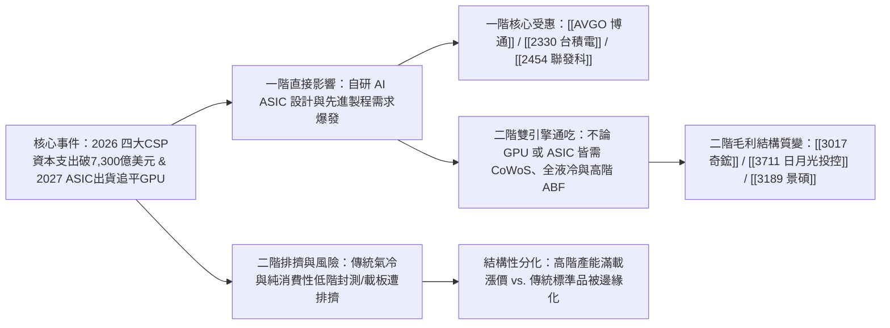

# 四大CSP資本支出與AI_ASIC黃金交叉追蹤

## 1. 事件核心摘要與最新狀態
> 全球四大雲端巨頭（[[MSFT 微軟]]、[[GOOGL Alphabet]]、[[AMZN 亞馬遜]]、[[META Meta]]）2026 全年資本支出（CapEx）確定衝上 **7,300 億～7,400 億美元**歷史新高（全球前九大 CSP 突破 9,500 億美元），並預計於 2027 年進一步擴張至 **1.3 兆～1.5 兆美元**。
> 最關鍵的產業結構轉折在於：為緩解龐大硬體折舊壓力並優化「每瓦特產出 Token 數」的推論經濟學，四大 CSP 全力衝刺自研 [[AI ASIC]]（Google TPU、AWS Trainium、Meta MTIA、Microsoft Maia），預估 **2027 年 AI ASIC 出貨量將首度追平或超越通用型 GPU**，使供應鏈訂單從單一輝達鏈擴散至「GPU + ASIC 雙引擎通吃」的晶圓代工、先進封裝、液冷散熱與高階 ABF 載板廠。（來源：[raw](../../raw/2026-11-23_四大CSP資本支出與奇鋐日月光景碩實質毛利營收數據.md)）

## 2. 一階與二階產業鏈傳導路徑

### 傳導明細與多空評估
- **一階傳導（直接衝擊）**：
  - [[AVGO 博通]]：`🟢 利多`（`🏗️ 中長期基本面`）— 全球 CSP 自研 AI ASIC 最大設計與高速 SerDes IP 夥伴，直接受惠 2027 年 ASIC 與 GPU 出貨黃金交叉。
  - [[2330 台積電]]：`🟢 利多`（`🏗️ 中長期基本面`）— 無論終端是 [[NVDA 輝達]] GPU 或四大 CSP 自研 ASIC，皆100%依賴台積電 3nm/2nm 與 [[CoWoS]] 產能，毛利率穩居 53%+ 高標並具備 2027 漲價空間。
  - [[NVDA 輝達]]：`🟡 中立/觀察`（`🏗️ 中長期基本面`）— 雖然 CSP 資本支出總餅擴大確保輝達 Rubin NVL72 絕對出貨量高成長，但 2027 年推論端市佔率面臨客戶自研 ASIC 分食，需靠機櫃級整合與 NVLink 生態護城河維持高毛利。
- **二階傳導（上下游連動 / 毛利結構質變）**：
  - [[3017 奇鋐]]：`🟢 利多`（`🏗️ 中長期基本面`）— 同時通吃輝達 GPU 與四大 CSP 自研 ASIC 水冷訂單，預計 **2027 年 ASIC 散熱營收將正式超越 GPU 散熱營收**，帶動毛利率站上 33.86% 歷史新高區間。
  - [[3711 日月光投控]]：`🟢 利多`（`🏗️ 中長期基本面`）— CSP 自研 ASIC 大量採用日月光 FOCoS 與類 [[CoWoS]] 全製程服務，推動封測毛利率突破 30.6%（「過去的天花板變地板」），2027 年 LEAP 先進封裝營收將由 40 億美元翻倍至 80 億美元。
  - [[3189 景碩]]：`🟢 利多`（`🏗️ 中長期基本面`）— AI ASIC 與 Vera CPU 朝大尺寸 Chiplet 發展，高階 ABF 載板稼動率達 80~90%，毛利率衝上 33.94%（創 15 季新高）。

## 3. 事件演進時間軸 (Timeline)
- **2026-11-23**：收錄四大 CSP 2026 年資本支出達 7,300~7,400 億美元、2027 年九大 CSP 上看 1.3~1.5 兆美元，以及 2027 年 AI ASIC 出貨量將首度追平或超越 GPU 之傳導數據（來源：[raw](../../raw/2026-11-23_四大CSP資本支出與奇鋐日月光景碩實質毛利營收數據.md)）。
