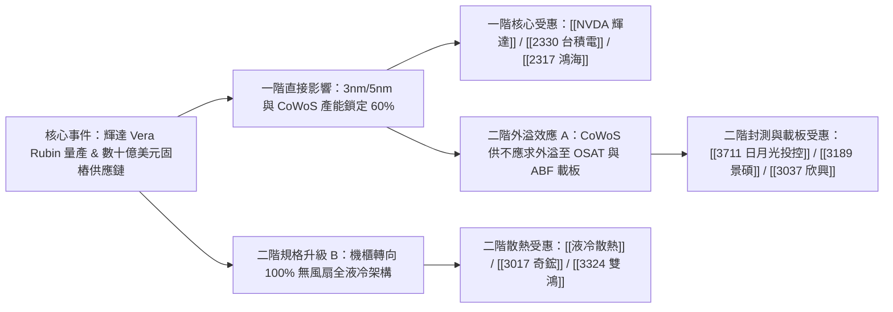

# 輝達Rubin平台量產與供應鏈固樁計畫

## 1. 事件核心摘要與最新狀態
> [[NVDA 輝達]] 次世代 **Vera Rubin NVL72** 系統與 Vera CPU 正式進入量產出貨階段，不僅包辦 [[2330 台積電]] 約 6 成的 [[CoWoS]] 產能（台積電月產能邁向 12~13 萬片），更為了解決先進封裝與載板的結構性瓶頸，直接祭出數十億美元長約與資金承諾，將訂單強烈外溢至非台積陣營封測廠（[[3711 日月光投控]] 旗下矽品）與台灣 ABF 載板廠（[[3189 景碩]]、[[3037 欣興]]）。同時，Rubin 機櫃散熱架構全面走向「無風扇 100% 全液冷模組化設計」，確立 [[液冷散熱]] 與主力伺服器 ODM [[2317 鴻海]] 的中長期基本面動能。（來源：[raw](../../raw/2026-11-23_輝達Rubin量產與擴大投資台灣先進封裝載板供應鏈.md)）

## 2. 一階與二階產業鏈傳導路徑

### 傳導明細與多空評估
- **一階傳導（直接衝擊）**：
  - [[NVDA 輝達]]：`🟢 利多`（`🏗️ 中長期基本面`）— Vera Rubin NVL72 進入量產出貨，且透過長約鎖定至 2028~2029 年之封裝與載板產能，消除供給瓶頸與產品藍圖不確定性。
  - [[2330 台積電]]：`🟢 利多`（`🏗️ 中長期基本面`）— Rubin 平台全面採用台積電 3nm/5nm 與 [[CoWoS]]，輝達獨佔約 60% CoWoS 產能，確保高階製程與先進封裝稼動率維持滿載。
  - [[2317 鴻海]]：`🟢 利多`（`🏗️ 中長期基本面`）— 作為高階 NVL72 機櫃級系統主力 ODM 夥伴，受惠於新平台放量交付。
- **二階傳導（上下游連動 / 訂單外溢 / 規格升級效應）**：
  - [[3711 日月光投控]]（旗下矽品 SPIL）：`🟢 利多`（`🏗️ 中長期基本面`）— 典型「台積電 [[CoWoS]] 產能滿載外溢效應」，獲輝達數十億美元資金支持擴建台灣先進封裝一站式產能（目標擴張至 2029 年中）。
  - [[3189 景碩]] / [[3037 欣興]]：`🟢 利多`（`🏗️ 中長期基本面`）— 高階 CoWoS 對大面積高層數 ABF 載板消耗倍增，景碩獲輝達長約支持擴建桃園幼獅廠專用產能（2027-2028 到位），欣興同步受惠多年期合作。
  - [[液冷散熱]]（[[3017 奇鋐]]、[[3324 雙鴻]]）：`🟢 利多`（`🏗️ 中長期基本面`）— Rubin 架構淘汰氣冷輔助，邁向 100% 機櫃級液冷（無風扇、獨立電源機櫃），微通道水冷板（Cold Plate）、快接頭（UQD）與分歧管（Manifold）之認證門檻與單櫃產值同步拉升。

## 3. 事件演進時間軸 (Timeline)
- **2026-11-23**：收錄輝達 Vera Rubin NVL72 量產出貨、包攬台積電 6 成 CoWoS 產能，並斥資數十億美元固樁矽品、景碩、欣興與全液冷供應鏈之最新動態（來源：[raw](../../raw/2026-11-23_輝達Rubin量產與擴大投資台灣先進封裝載板供應鏈.md)）。
